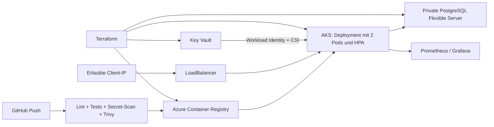

# LearningSteps Evolution

Dieses Projekt entwickelt die FastAPI-/PostgreSQL-Anwendung von CyberstepsDE zu einer automatisiert bereitstellbaren Azure-Anwendung weiter. Dokumentation und Betriebsanleitung sind auf Deutsch.

## Architektur



Terraform erstellt ein eigenes VNet mit getrennten AKS- und Datenbank-Subnetzen. PostgreSQL hat keinen öffentlichen Netzwerkzugang und verwendet Private DNS. AKS zieht Images ohne Registry-Passwort über seine Managed Identity. Der Datenbank-Verbindungsstring liegt in Key Vault und wird über eine dedizierte Workload Identity als schreibgeschützte CSI-Datei eingebunden. Die Anwendung liest diese Datei beim Start; nach einer Passwortrotation ist ein Rolling Restart notwendig, damit der Connection Pool die neuen Werte übernimmt.

## Lokal starten

Voraussetzungen: Git, Docker Desktop mit Linux-Containern, für die PowerShell-Skripte PowerShell 7.

```powershell
# Einmalig ein zufälliges lokales Testpasswort erzeugen:
"POSTGRES_PASSWORD=$([Convert]::ToHexString([Security.Cryptography.RandomNumberGenerator]::GetBytes(16)))" | Set-Content .env
docker compose up -d --build
./scripts/smoke.ps1
```

Swagger UI: http://localhost:8000/docs. Die Datenbank ist lokal nicht nach außen veröffentlicht. `docker compose down` beendet die Container; das Datenvolume bleibt bestehen. Es werden ausschließlich synthetische Testdaten verwendet.

## API und Betrieb

- CRUD-Endpunkte unter `/entries`; Eingaben werden validiert, unbekannte und interne Felder abgewiesen.
- `/health/live`: Prozess lebt; unabhängig von PostgreSQL.
- `/health/ready`: Datenbank und Tabelle erreichbar; bei Ausfall HTTP 503.
- `/metrics`: Prometheus-Zähler, Histogramme und Datenbank-Erreichbarkeit. Routen statt konkreter IDs verhindern unbeschränkte Metrik-Labels.
- Ein gemeinsamer Connection Pool pro Pod, strukturierte Konsolenausgabe ohne Verbindungsstring.
- PATCH erhält unveränderte Felder; Einzelabruf und Einzellöschung sind implementiert.

## Azure bereitstellen

Voraussetzungen: angemeldete Azure CLI, Terraform >= 1.7, kubectl, ausreichende Azure-Quota und Berechtigungen für die Projektressourcen und ihre Rollenzuweisungen.

```powershell
az login
terraform -chdir=infra-terraform init
# terraform.tfvars.json lokal anlegen: subscription_id, admin_cidr (eigene öffentliche IPv4/32)
terraform -chdir=infra-terraform plan -out=deployment.tfplan
terraform -chdir=infra-terraform apply deployment.tfplan
$config = terraform -chdir=infra-terraform output -json deployment | ConvertFrom-Json
az acr login --name $config.registry
docker build -t learningsteps:local .
docker tag learningsteps:local "$($config.login_server)/learningsteps:initial"
docker push "$($config.login_server)/learningsteps:initial"
./scripts/deploy.ps1 -ImageTag initial -ClientCidr 'DEINE_IP/32'
kubectl get svc -n learningsteps
./scripts/smoke.ps1 -BaseUrl 'http://LOADBALANCER_IP'
```

Der Migration-Job erstellt das idempotente Schema unter einer PostgreSQL-Advisory-Lock. Erst nach erfolgreicher Migration wird die Betriebsbereitschaft bestätigt. Container laufen ohne Root, mit schreibgeschütztem Dateisystem, ohne zusätzliche Linux-Capabilities und mit Ressourcenlimits. Zwei Replikate, Probes, Rolling Updates, PodDisruptionBudget und HPA (70 % CPU, 2–4 Pods) sind konfiguriert. Ein einzelner günstiger AKS-Knoten ist für den Budget-Test vorgesehen; für Ausfallsicherheit bei Knotenausfall sind mindestens zwei Knoten erforderlich.

## GitHub Actions

Jeder Push und Pull Request führt Lint, API-Tests, Terraform-Validierung, Gitleaks und Trivy aus. Jeder HIGH-/CRITICAL-Befund führt zu einem Fehler. Erst das gescannte Image wird als kurzlebiges Artefakt in den Deployment-Job übernommen, nach ACR gepusht und mit unveränderlichem Commit-Tag bereitgestellt. Pull Requests deployen nicht. Das Deployment verwendet Azure OIDC statt gespeicherter Azure-Passwörter.

Terraform erstellt zusätzlich eine eigene GitHub-Deployment-Identität mit OIDC-Föderation für `repo:lehnermarkus-del/learningsteps:environment:azure`. Sie erhält AcrPush am Projekt-ACR und AKS Contributor am konkreten Projekt-Cluster. Sie erhält keinen Zugriff auf Key-Vault-Inhalte oder andere Ressourcengruppen. Die AKS-Rolle ist für den Übungsbetrieb bewusst auf den einen kurzlebigen Cluster beschränkt; für Dauerbetrieb sollten Clusterverwaltung und Anwendungs-RBAC weiter getrennt werden.

Nach `terraform apply` erzeugt `./scripts/configure-github.ps1 -Enable` die Datei `deployment-config.json` mit Ressourcenkennungen (keinen Passwörtern). Nach Commit und Push auf `main` läuft das Deployment automatisch im Environment `azure`. Ohne `-Enable` beziehungsweise mit `{"enabled": false}` bleibt CI aktiv und die kostenpflichtige Bereitstellung deaktiviert. Die Konfiguration ist im Auslieferungszustand deaktiviert, damit ein späterer Push keine abgebauten Testressourcen anspricht.

Für den kurzlebigen GitHub-Runner wird ausschließlich dessen /32 zur bestehenden API-Zugriffsliste hinzugefügt und im `always()`-Schritt wieder entfernt. Die ursprüngliche Client-IP wird zur Laufzeit aus Azure gelesen und nicht in den Quellcode geschrieben. Der Service bleibt auf den ursprünglichen Client beschränkt. Kein Datenbankpasswort und kein Terraform-State wird in GitHub gespeichert. Ein erlaubtes Deployment muss den vorhandenen Terraform-Aufbau verwenden; die Pipeline führt kein automatisches `terraform apply` oder `destroy` aus.

## Monitoring (optional)

Lokal: ein zufälliges `GRAFANA_PASSWORD` in `.env` ergänzen und `docker compose -f compose.yaml -f compose.monitoring.yaml up -d` ausführen. Grafana läuft unter http://localhost:3000 (Benutzer `admin`), Prometheus unter http://localhost:9090. Datenquelle und deutsches Dashboard werden automatisch provisioniert.

`monitoring/values.yaml` konfiguriert kube-prometheus-stack mit kurzer Datenhaltung. Installation mit Helm, anschließend Dashboard `monitoring/dashboard.json` in Grafana importieren. Grafana bleibt ClusterIP und wird nur per Port-Forward geöffnet. Das Dashboard zeigt Anfragevolumen, p95-Antwortdauer, Datenbankstatus und 5xx-Fehler. Monitoring benötigt zusätzliche Knotenkapazität und ist vom Pflichtteil getrennt.

## Kosten, State und Abbau

Für diesen Auftrag ist ein Gesamtbudget von 20 € freigegeben. Die Umgebung dient einem kurzen Testlauf und wird anschließend wieder abgebaut. AKS Free bezeichnet nur die kostenlose Control Plane; VM, Disks, LoadBalancer, IP, PostgreSQL, Registry und Transaktionen kosten weiterhin Geld. Ein Budgetalarm ist keine harte Kostensperre. Vor einem späteren Wiederaufbau aktuelle Preise und Laufzeit prüfen.

```powershell
terraform -chdir=infra-terraform plan -destroy
terraform -chdir=infra-terraform destroy
```

Terraform-State enthält vertrauliche Daten einschließlich Datenbankpasswort und bleibt lokal, git-ignoriert. Für Team-/Dauerbetrieb einen verschlüsselten Azure-Blob-Backend mit Zugriffskontrolle und State-Locking einrichten. Key Vault verwendet Lösch- und Purge-Schutz: der gelöschte Vault bleibt während seiner Aufbewahrung wiederherstellbar. Für einen Neuaufbau wird eine neue zufällige Namenskennung verwendet.

## Grenzen des Übungsbetriebs

Die API hat keine Benutzeranmeldung und soll deshalb ausschließlich über die erlaubte Client-IP mit synthetischen Daten verwendet werden. Für öffentlichen Dauerbetrieb sind TLS, Authentifizierung, Autorisierung, dedizierter DB-Runtime-Benutzer, mehrere AKS-Knoten, Alarmierung und gesicherter Remote-State ergänzend erforderlich. HTTP ist nur für den eingeschränkten Testzugriff vorgesehen.

## Nachweise

Die Dateien in `docs/` enthalten tatsächlich ausgeführte Prüfungen. Erfolgreiche Live-Deployments, GitHub-Läufe und Abbau werden dort mit ihrem wirklichen Status dokumentiert. Eine Konfigurationsdatei allein ist kein Nachweis eines erfolgreichen Cloud-Betriebs.

## Quellen

- [Ausgangscode](https://github.com/CyberstepsDE/learningsteps)
- [AKS Terraform-Ressource](https://registry.terraform.io/providers/hashicorp/azurerm/latest/docs/resources/kubernetes_cluster)
- [Key Vault CSI und Workload Identity](https://learn.microsoft.com/en-us/azure/aks/csi-secrets-store-identity-access)
- [AKS-Preise](https://azure.microsoft.com/en-us/pricing/details/kubernetes-service/)


